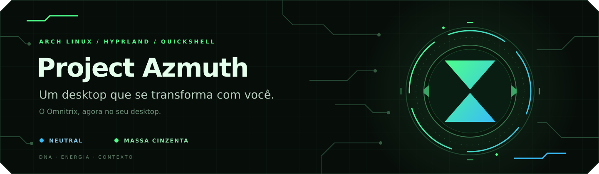

# Project Azmuth

<p align="center">
  
</p>

<p align="center">
  <strong>Arch Linux · Hyprland · Quickshell · Python</strong><br>
  <a href="docs/INSTALACAO-E-CONFIGURACAO.md">Instalação e configuração</a> ·
  <a href="docs/MANUAL.md">Manual de uso</a> ·
  <a href="docs/DNA_Schema_Spec.md">Criar um DNA</a> ·
  <a href="filemanager/README.md">Dolphin</a> ·
  <a href="taskmanager/README.md">Gerenciador de tarefas</a>
</p>

**O Omnitrix, agora no seu desktop.**

Project Azmuth é uma rice para Arch Linux e Hyprland que transforma o desktop
em um Omnitrix interativo. Cada alien representa um **DNA**: um perfil que reúne
aparência, organização das janelas, aplicativos e comportamento do ambiente.

Você abre o disco, escolhe uma transformação e entra em outro jeito de trabalhar.
O verde do Massa Cinzenta toma a interface; as janelas se reorganizam, o terminal
acompanha a paleta e o Omnitrix começa a consumir energia. Ao voltar ao Neutral,
o sistema recarrega para a próxima transformação.

O nome homenageia Azmuth, o Galvan criador do Omnitrix em *Ben 10*. O projeto
foi concebido e é mantido por **[Miguel Do Vale](https://github.com/Miguel-doVale)**.

## Um DNA para cada forma de usar o computador

Um DNA é descrito em YAML e aplicado pelo motor do Azmuth durante a sessão.
Ele define a paleta, o wallpaper, o layout do Hyprland, os aplicativos que podem
abrir e os gatilhos de contexto.

| DNA | Identidade | Uso atual |
| --- | --- | --- |
| **Neutral** | Azul elétrico, Arch no núcleo | Uso diário e recarga do Omnitrix. |
| **Massa Cinzenta** | Verde galvânico, silhueta do alien | Desenvolvimento e foco, com layout e aplicativos próprios. |

Esses são os dois estados disponíveis hoje. Os outros nove aliens clássicos
estão no catálogo e aparecem bloqueados até receberem um DNA funcional.

A abertura automática de aplicativos por transformação pode ser configurada
na Central. O ambiente deve acompanhar a tarefa que você escolheu.

## O que já ganhou vida

| Sistema | O que você encontra |
| --- | --- |
| **Omnitrix HUD** | Disco interativo, navegação por setas ou scroll, seleção de DNA, arte do alien e animação de transformação. |
| **Desktop vivo** | Núcleo que muda entre Arch e Omnitrix, circuitos animados, silhueta do alien e anéis de energia e métricas. |
| **Barra galvânica** | Workspaces, aplicativos, bandeja, rede, áudio, bateria e o DNA ativo em uma identidade visual comum. |
| **Constelação** | Alternância de janelas e exploração espacial de workspaces, com miniaturas ao vivo, zoom e navegação WASD. |
| **Lançador de aplicativos** | Disco com playlists editáveis: nome, runa, cor, ordem e aplicativos. Apps sem playlist continuam acessíveis. |
| **Desktop canvas** | Widgets que você arrasta e redimensiona, com guias de alinhamento e medidas dos espaços entre eles. |
| **Calendário** | Eventos, cores, horários e lembretes; criação rápida pelo próprio widget e edição pela Central. |
| **Área de transferência** | Busca, filtros, favoritos, prévias de imagens, amostras de cores e exclusão em lote. |
| **Central** | Configurações do Omnitrix, playlists, widgets, calendário, Wi-Fi, som e diagnóstico do sistema. |
| **Gerenciador de tarefas** | Processos com busca, ordenação, pausa e encerramento; gráficos reais de CPU, memória, disco e rede; controle dos aplicativos de inicialização e de cada DNA. |
| **Dolphin** | Paleta do DNA, navegação compacta e editor de pastas com cores livres, runas, texto e camadas de marcadores. |
| **Notificações** | Servidor próprio, ações, histórico no Dashboard, limite de itens visíveis e modo Não perturbe. |
| **Capturas e gravação** | Seleção de área direta, capturas de tela/janela e gravação, com arquivos salvos e integração com a área de transferência. |
| **Login SDDM** | Tema opcional do Omnitrix para a entrada na sessão. |
| **Terminal** | Kitty, prompt e banner do Omnitrix, cores do DNA e botão direito para colar. |
| **Bloqueio e energia** | Tela de bloqueio temática, sequência de movimentos do Omnitrix, senha do sistema em runas e menu de energia próprio. |

O bloqueio personalizado e a integração da sessão ainda fazem parte de uma
rice em desenvolvimento. A senha do sistema continua disponível no modo de
autenticação por PAM.

## As regras do Omnitrix

A experiência também tem comportamento inspirado no dispositivo:

- **Energia:** por padrão, uma transformação descarrega em 10 minutos;
  o Neutral recarrega em 5. A duração e os limites são ajustáveis.
- **Destransformação:** a carga chega a zero e o sistema retorna ao Neutral.
- **Master Control:** acesso direto aos DNAs disponíveis e carga congelada.
- **Life-Form Lock:** mantém o DNA escolhido até a liberação.
- **Failsafe:** retorna ao Neutral em condições de bateria crítica ou
  temperatura elevada.
- **Sinais do núcleo:** amarelo para coleta de DNA/downloads, azul para
  recalibração durante atualizações e vermelho para recarga.

Esses mecanismos organizam a experiência do desktop. Seus limites e
comportamentos estão descritos no [manual](docs/MANUAL.md).

## Runas Galvan

O Azmuth já tem **24 runas próprias**, com significados como Mente, Código,
Energia, Tempo, Rede e Núcleo. Elas aparecem nas playlists, nos menus, no
bloqueio e nos marcadores de pastas.

A próxima etapa é desenvolver esse conjunto como uma linguagem: combinações,
significados, dicionário e tradutor. A gramática ainda está em construção.

A fonte dos símbolos fica em [tools/gen_galvan.py](tools/gen_galvan.py).
O conjunto gerado é compartilhado pela interface em [shell/Galvan.js](shell/Galvan.js).

## Contexto e assistente

O **Context Engine** atual funciona por regras. Ele observa o aplicativo em
foco e pode sugerir um DNA apropriado; com Master Control, pode aplicar a
transformação automaticamente. As sugestões respeitam intervalos de espera
para evitar trocas a cada alternância de janela.

O **assistente Azmuth** usa o Ollama local, sem conta de IA ou chave de API.
O modelo inicial é `qwen3.5:4b`; a primeira base de conhecimento cobre os
personagens, continuidades e aliens clássicos de Ben 10. O guia de instalação
explica como instalar o Ollama, baixar o modelo e verificar a conexão.

A conversa e o contexto do Omnitrix são enviados somente ao serviço local em
`127.0.0.1:11434`. O contexto inclui DNA, energia, eventos e títulos/classes de
janelas; o assistente não indexa nem lê documentos pessoais. Ele age por uma
lista validada de comandos `azmuth`, sem terminal genérico ou comandos de
energia que desliguem o computador. A conversa é mantida por 30 minutos sem uso; o histórico fica armazenado localmente.

## Atalhos para começar

| Atalho | Ação |
| --- | --- |
| `Super + Space` | Abrir o Omnitrix e escolher um DNA. |
| `Super + Esc` | Voltar ao Neutral. |
| `Super + D` | Abrir o lançador de aplicativos. |
| `Alt + Tab` | Alternar janelas pela Constelação. |
| `Super + Tab` | Explorar a Constelação com WASD. |
| `Super + W` | Abrir o Dashboard. |
| `Super + Shift + O` | Abrir a Central de Configuração. |
| `Ctrl + Shift + Esc` | Abrir o gerenciador de tarefas do Azmuth. |
| `Super + Alt + E` | Editar os widgets na área de trabalho. |
| `Super + E` | Abrir o Dolphin tematizado. |
| `Super + Shift + V` | Abrir a área de transferência. |
| `Super + Shift + S` | Capturar uma área da tela. |
| `Super + M` | Bloquear a sessão. |
| `Super + Shift + Q` | Abrir o menu de energia. |

No Dolphin: **clique direito numa pasta → Azmuth · ferramentas →
Personalizar pasta · cores e runas**. Escolha a cor, adicione os marcadores,
arraste para posicionar e clique em **Aplicar**.

A lista completa de atalhos, comandos e configurações está no
[Manual do Project Azmuth](docs/MANUAL.md).

## Experimentar na sua máquina

O Azmuth é desenvolvido e usado em uma instalação pessoal de **Arch Linux,
Hyprland com configuração Lua e Bash**. A preparação ainda é manual;
caminhos, fontes, aplicativos e configuração da sessão precisam ser
adaptados ao ambiente.

<details>
<summary><strong>Dependências e preparação</strong></summary>

### Base

- Hyprland com suporte à API Lua utilizada em `hypr/azmuth.lua`.
- Quickshell com os módulos de Wayland, Hyprland, PAM, PipeWire,
  MPRIS, notificações e Networking usados pela shell.
- Python 3 e PyYAML; Linux com `pidfd` para controlar processos.
- `gio` (GLib) para iniciar os aplicativos escolhidos no login.
- Hyprpaper, Hypridle, Kitty e Fastfetch.
- NetworkManager para Wi-Fi; PipeWire e WirePlumber para áudio.
- Cliphist e wl-clipboard para a área de transferência.
- Grim e Slurp para capturas; wf-recorder para gravação.
- Dolphin para o explorador tematizado.
- Rofi e Hyprlock para os caminhos de fallback.
- As fontes Orbitron, Rajdhani, JetBrainsMono Nerd Font e
  Font Awesome 7 Free usadas pela interface.

SDDM e Ollama são opcionais. Ollama é necessário apenas para usar o assistente;
o restante da rice não depende de um provedor de IA.
Pillow e NumPy são dependências das ferramentas de geração de arte e som.

### Preparar o motor

Na raiz do repositório:

```bash
python3 -m venv .venv
.venv/bin/python -m pip install PyYAML
.venv/bin/python src/core.py roster
```

O último comando lista os DNAs disponíveis sem transformar a sessão.

### Integrar a sessão

1. Ajuste `PROJECT` em `hypr/azmuth.lua` para o caminho onde você colocou
   o repositório. O valor atual é `~/Documents/Coding/Project Azmuth`.
2. Execute `.venv/bin/python src/core.py install`.
   O comando conecta a CLI, os arquivos do Hyprland, o Kitty e o Fastfetch,
   e acrescenta o prompt ao `.bashrc`. Configurações substituídas por
   links recebem uma cópia com o sufixo `.pre-azmuth`.
3. Garanta que `~/.local/bin` esteja no seu `PATH` e acrescente
   `require("azmuth")` ao seu `~/.config/hypr/hyprland.lua`.
4. Revise os atalhos e autostarts da sua configuração para evitar duas
   barras ou dois serviços de notificações disputando a sessão.
   Entre novamente na sessão para iniciar a shell e os serviços do Azmuth.

Os aplicativos de exemplo do Massa Cinzenta são VS Code, Kitty e Obsidian.
Adapte o YAML ou a configuração de aplicativos do DNA ao que você utiliza.

### Dolphin e login

```bash
# Dolphin: instalação própria com backup
azmuth files --setup

# SDDM: tema de login opcional, com privilégios administrativos
bash sddm/install.sh
```

O Dolphin tem documentação e restauração próprias em
[filemanager/README.md](filemanager/README.md).

</details>

## Pelo terminal

Para recuperar a rice, use **`azmuth send`** — pedir ao Azmuth que envie o
Omnitrix de volta. Ele inicia os componentes ausentes, recupera as notificações
quando o Dunst assumiu a reserva e reaplica o DNA salvo. **`azmuth doctor`**
confere a interface, os serviços, as ferramentas e os dados da sessão.

```bash
azmuth send                       # recuperar o Omnitrix
azmuth doctor                     # diagnóstico da sessão
azmuth apply massa_cinzenta       # transformar
azmuth neutral                    # retornar à base
azmuth current                    # DNA atual
azmuth roster                     # catálogo de DNAs
azmuth tasks                      # gerenciador de tarefas
azmuth tasks --tab startup         # aplicativos de inicialização
azmuth files --split projetos downloads
```

## Arquitetura

| Camada | Responsabilidade | Fonte |
| --- | --- | --- |
| **DNA** | Paletas, layout, wallpaper, apps, serviços e gatilhos de contexto. | `dna/*.yaml` |
| **Motor** | Validar os perfis, aplicar transformações, controlar o estado e oferecer a CLI. | `src/core.py` |
| **Shell** | Barra, discos, painéis, notificações, bloqueio, widgets e Constelação. | `shell/*.qml` |
| **Sessão** | Atalhos, autostart, recuperação dos componentes e diagnóstico por Lua e IPC. | `hypr/azmuth.lua`, `src/session_runtime.py` |
| **Contexto** | Observar o uso, sugerir DNAs e acompanhar condições do sistema. | `src/context_engine.py` |
| **Assistente** | Preparar o contexto e consultar o provedor de IA configurado na implementação. | `src/azmuth_ai.py` |
| **Arquivos** | Aplicar o tema do Dolphin e compor ícones de pastas com marcadores. | `src/file_manager.py`, `src/folder_style.py` |
| **Diagnóstico** | Ler processos e métricas do Linux, controlar tarefas e gerenciar inicialização numa janela independente. | `src/task_manager.py`, `taskmanager/` |

Os perfis ficam no repositório; preferências e dados de execução ficam
em `~/.local/state/azmuth/`. A configuração Lua liga esses componentes
à sessão do Hyprland.

## Dentro do projeto

```text
assets/        Artes, wallpapers e sons
bin/           Entrada da CLI azmuth
dna/           Perfis e catálogo do Omnitrix
docs/          Manual, conceitos e especificação de DNA
filemanager/   Tema do Dolphin e editor de pastas
hypr/          Integração Lua e configurações da sessão
shell/         Interface Quickshell/QML
src/           Motor, contexto, assistente e integrações
terminal/      Kitty, prompt e Fastfetch
taskmanager/   Gerenciador de tarefas nativo e telemetria
tests/         Testes de processos e inicialização
sddm/          Tema de login
tools/         Geradores de runas, arte e sons
```

As preferências, os eventos e o estado de execução são gravados em
`~/.local/state/azmuth/`, fora da árvore do código.

## Próximas transformações

- Lapidar a experiência dos sistemas existentes no uso diário.
- Desenvolver a linguagem Galvan, seu dicionário e tradutor.
- Aprofundar a base de Ben 10 do assistente e evoluir a IA de contexto por regras.
- Definir a função de cada alien antes de habilitar novos DNAs.
- Tornar a instalação mais fácil de reproduzir em outras máquinas.

O segundo Core voltado a segurança e as formas Ultimate continuam como
visões futuras. O foco atual é consolidar o Arch Core e os DNAs que já existem.

## Participar

Ideias de interação, relatos de bugs, documentação e melhorias visuais
ajudam o projeto a evoluir. Ao propor um novo alien, explique como a
habilidade dele se traduz em uma função útil do desktop.

Para entender a intenção do projeto, leia o
[documento-mestre](docs/00%20-%20MASTER%20-%20Project%20Azmuth.md).
Ele também registra decisões e histórico; algumas seções refletem etapas
anteriores. Para operação atual, consulte o manual e o código.

## Autoria, licença e referências

**Concepção, direção e manutenção:** Miguel Do Vale
([@Miguel-doVale](https://github.com/Miguel-doVale), também conhecido como Sun_Akuma).

Copyright (C) 2026 Miguel Do Vale.

O código original do Project Azmuth é distribuído sob a **GNU General Public
License v3.0**, identificador **GPL-3.0-only**. O texto integral está em
[LICENSE](LICENSE).

A licença permite usar, modificar e redistribuir o código, inclusive
comercialmente, com as obrigações de preservar os avisos de autoria e
licença e disponibilizar o código correspondente das versões distribuídas
nas condições da GPL-3.0.

Ao divulgar o projeto, identifique o Project Azmuth e sua origem.

Este é um projeto independente de fã, inspirado em *Ben 10*, sem afiliação
oficial. Personagens, nomes, símbolos e outros elementos da franquia
pertencem aos respectivos titulares. Referências à franquia não concedem
direitos sobre esses materiais.
